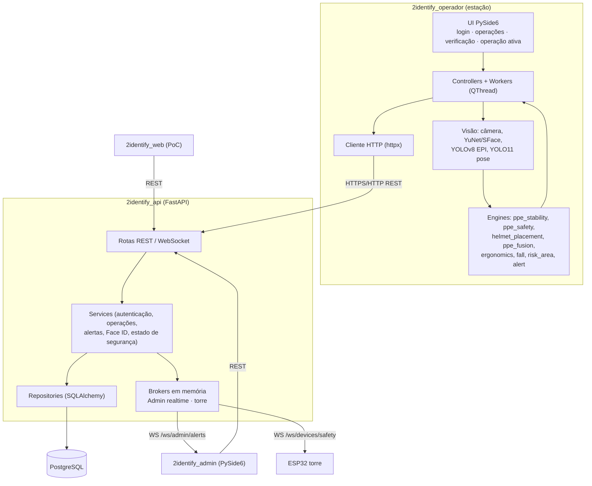
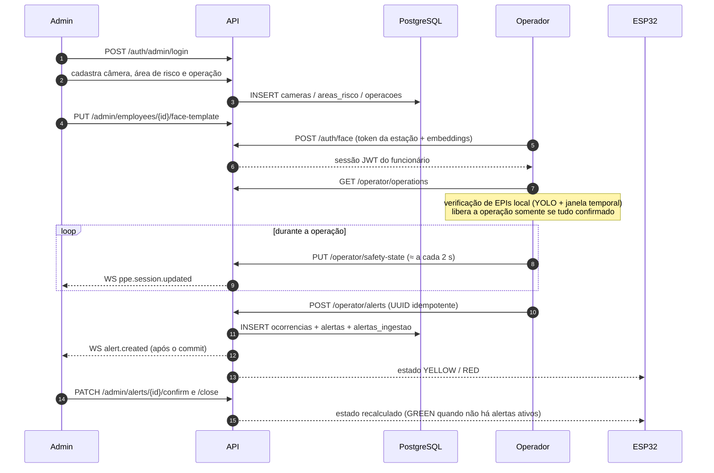

# Arquitetura Final — SafeVision Metaindústria / 2Identify (Sprint 4)

Documento baseado no código copiado da branch `redesign/fase2-design-system` do 2Identify
(commit `36252b8`). Onde algo não foi validado nesta entrega, isso está dito explicitamente.

## 1. Visão geral

O 2Identify é composto por **dois clientes desktop**, **uma API central** e **dispositivos
auxiliares**:

- o **Operador** fica na estação de trabalho, captura vídeo e executa a IA localmente;
- o **Admin** é usado pelo gestor de segurança para cadastros, acompanhamento e tratamento de alertas;
- a **API** é a única peça que acessa o PostgreSQL e concentra autenticação, regras de negócio,
  persistência e distribuição de eventos em tempo real;
- a **torre ESP32** e o **PoC web** consomem o estado e os alertas publicados pela API.

## 2. Componentes e responsabilidades

### 2.1 `2identify_api`

| Recurso | Rotas principais | Responsabilidade |
|---|---|---|
| Saúde | `GET /`, `GET /health` | `/health` só retorna 200 após um `SELECT 1` real; 503 sanitizado se o banco cair. |
| Autenticação | `POST /auth/login`, `POST /auth/face`, `POST /auth/admin/login` | Operador por senha (bcrypt), funcionário por Face ID (token de estação + embeddings) e administrador; JWT com audiences separadas (`2identify-operator` / `2identify-admin`). |
| Admin | `GET /admin/me`, `GET /admin/dashboard/summary`, `GET /admin/active-operations` | Revalidação da conta a cada requisição, indicadores e projeção das operações ativas. |
| Funcionários | `GET/POST/PUT /admin/employees`, `GET/PUT /admin/employees/{id}/face-template` | Cadastro e template facial central. |
| Operações | `GET /admin/operations/catalog`, `GET/POST/PUT /admin/cameras`, `/admin/risk-areas`, `/admin/operations` | Câmeras, áreas de risco (polígonos normalizados) e operações com EPIs obrigatórios. |
| Alertas (Admin) | `GET /admin/alerts`, `GET /admin/alerts/{id}`, `PATCH .../confirm`, `PATCH .../close` | Histórico e tratamento auditado. |
| Operador | `GET /operator/operations`, `GET /operator/operations/catalog`, `.../cameras`, `POST /operator/alerts`, `PUT /operator/safety-state` | Leitura de operações, ingestão idempotente de alertas e snapshots de EPI. |
| Tempo real | `WS /ws/admin/alerts`, `WS /ws/devices/safety` | Eventos para o Admin e estado para a torre. |

### 2.2 `2identify_admin`

Desktop PySide6 organizado em `ui` → `controllers` → `services` → `api` (cliente HTTP) e
`realtime` (cliente WebSocket). Telas: Central de segurança, Alertas, Gestão de EPIs (tempo real),
Operações e Áreas (câmeras + editor de polígono), Funcionários (com captura de Face ID),
Relatórios (Excel) e Configurações (placeholder). O token JWT fica apenas em memória.

### 2.3 `2identify_operador`

Desktop PySide6 com fronteiras explícitas: `ui`, `controllers`, `workers` (QThread), `vision`
(adaptadores OpenCV/Ultralytics), `engine` (regras puras, sem Qt), `services`, `providers` e `api`.
Cada câmera tem captura própria; os quadros de análise são agendados com política
*latest-frame-wins* para não acumular atraso.

### 2.4 `2identify_web` e firmware

- `2identify_web`: página estática (ES modules) com login administrativo e lista de alertas,
  atualizada a cada 30 s; testada com `node --test`.
- `firmware/esp32_safety_signal`: cliente WebSocket que traduz `GREEN`/`YELLOW`/`RED` em relés
  (verde, amarelo, vermelho e buzina) com estado `DISCONNECTED` e watchdog.

## 3. Stack tecnológica e justificativas

| Escolha | Justificativa observada no projeto |
|---|---|
| Python 3.12 em todos os módulos | Ecossistema de IA (PyTorch/Ultralytics/OpenCV) e de desktop (Qt) na mesma linguagem. |
| FastAPI + Pydantic | Contratos validados, documentação OpenAPI automática (`/docs`), suporte nativo a WebSocket. |
| SQLAlchemy 2 síncrono + psycopg2 | Simplicidade e previsibilidade; transações curtas por requisição. |
| Alembic | Evolução do esquema versionada; `autogenerate` bloqueado para evitar migrações incorretas. |
| PostgreSQL | Integridade referencial, JSON/JSONB para geometria e embeddings, confiabilidade. |
| PySide6 (Qt 6) | Interfaces desktop nativas, gráficos e WebSocket sem dependências extras. |
| Inferência local na estação | Baixa latência, funciona com rede instável e evita enviar vídeo a servidores. |
| YOLOv8 customizado + YOLO11n-pose | Detecção de EPIs em tempo real e keypoints para ergonomia, capacete e área de risco. |
| YuNet + SFace (OpenCV Zoo) | Modelos leves de detecção/reconhecimento facial em ONNX, executados em CPU. |
| JWT curtos + bcrypt | Sessões stateless com expiração; senhas nunca armazenadas em texto. |
| ESP32 + WebSocket | Hardware barato para sinalização; conexão persistente com heartbeat. |

## 4. Fluxo de dados entre as aplicações

## 5. Integração dos módulos

- **Contrato único pela API.** Nenhum desktop acessa o banco no fluxo normal. O `DATABASE_URL` do
  Admin existe apenas para o `seed.py` (ferramenta legada).
- **Mapeamento EPI → classe do modelo.** O Operador traduz os EPIs cadastrados (por código, ex.:
  `EPI-001` → `capacete`, ou por nome) para as classes do detector. EPI sem classe correspondente
  fica "SEM MAPEAMENTO" e bloqueia a liberação.
- **Câmeras.** O Admin cadastra fontes USB (índice) ou IP (URL). Respostas administrativas mascaram
  a senha; o Operador recebe a fonte necessária para abrir o stream. `CAMERA_SOURCE_<id>` no `.env`
  local sobrepõe a fonte em cada estação.
- **Tokens compartilhados.** `OPERATOR_CATALOG_TOKEN` (leitura do catálogo), `OPERATOR_STATION_TOKEN`
  (Face ID) e `SAFETY_DEVICE_TOKEN` (torre) precisam ter o mesmo valor nos lados correspondentes.

## 6. Persistência

Banco PostgreSQL `identify_db`, esquema criado por 10 revisões Alembic (head `a3c5e7f9b1d2`).
Tabelas: `usuarios`, `setores`, `funcionarios`, `epis`, `funcionario_epis`, `cameras`,
`areas_risco`, `operacoes`, `operacao_epis`, `ocorrencias`, `alertas`, `alertas_ingestao`,
`funcionario_face_templates` e `alembic_version`.

- `areas_risco.geometria`: polígono com coordenadas normalizadas (0–1), independente da resolução.
- `alertas_ingestao`: UUID do evento e hash do payload — garante idempotência (repetição idêntica
  retorna `duplicate=true`; mesmo UUID com outro conteúdo retorna 409).
- `alertas`: auditoria de confirmação e encerramento, e resolução física separada do encerramento administrativo.
- `funcionario_face_templates`: embeddings SFace por funcionário; downgrade bloqueado para não apagar biometria.

A criação do esquema do zero foi **validada** nesta entrega (PostgreSQL 18.6).

## 7. Comunicação em tempo real

- `WS /ws/admin/alerts`: autenticação somente por header `Authorization: Bearer` (query string é
  rejeitada); envelope versionado (`schema_version: 1`) com `connection.ready`,
  `connection.heartbeat`, `alert.created` e `ppe.session.updated`; filas limitadas por cliente e
  limites globais e por administrador; revalidação periódica da conta.
- `WS /ws/devices/safety`: token exclusivo do dispositivo; estado agregado dos alertas não
  encerrados (nenhum = GREEN, aviso = YELLOW, crítico = RED); reenvio periódico como heartbeat;
  apenas sessões do Operador que continuam reportando (liveness de 30 s) influenciam a torre.
- O Admin reconecta com backoff e jitter. Os brokers são **em memória**: use um único worker do
  Uvicorn; não há replay de eventos após reinício.

## 8. Integração da Inteligência Artificial

| Etapa | Implementação |
|---|---|
| Face ID | YuNet detecta um único rosto; prova de vida temporal (movimento mínimo por tempo mínimo); SFace gera embeddings de quadros consecutivos; a API decide por similaridade de cosseno com limiar (0,50) e margem de ambiguidade (0,05). |
| EPI | YOLOv8 customizado retreinado (`best.pt`, 11 classes; ~35 ms por quadro 1280×720 em CPU na validação) a ~4 FPS; verificação de integridade por SHA-256 antes de carregar; janela de 8 quadros (mín. 5) com limiares 75 %/25 %; tracking por classe na operação ativa. |
| Sujeito da verificação | A liberação considera exatamente uma pessoa observada de forma confiável. |
| Capacete | Confirmado somente quando a pose indica o capacete na cabeça (`NA_CABECA`); na mão bloqueia. |
| Multicâmera | Cada câmera estabiliza suas evidências; a fusão nunca deixa uma câmera inconclusiva votar contra. |
| Pose / ergonomia | YOLO11n-pose (COCO, 17 keypoints) a ~4 FPS; tronco (alerta 20°, crítico 45°), braços acima dos ombros; joelhos desligados por padrão. |
| Queda | Tronco próximo da horizontal e corpo mais largo que alto, confirmado por tempo e número de quadros. |
| Área de risco | Pontos confiáveis do corpo dentro do polígono calibrado geram violação `person_in_risk_area`. |
| Alertas | Debounce (3 observações / 0,75 s), resolução estável, cooldown de 30 s e escalonamento para crítico após 5 s. |

## 9. Principais decisões arquiteturais

1. **API como única fronteira com o banco** — reduz superfície de ataque e centraliza regras.
2. **IA na borda (estação)** — vídeo não trafega pela rede; a API recebe apenas eventos.
3. **Fail-closed na liberação** — ausência de evidência nunca é tratada como conformidade.
4. **Idempotência dos alertas** — reenvios por falha de rede não duplicam ocorrências.
5. **Identidade decidida pelo servidor** — no Face ID o cliente envia embeddings; quem escolhe o funcionário é a API.
6. **Segredos fora do Git** — `.env` locais, exemplos com placeholders que a API recusa.
7. **Engines independentes de Qt** — regras de segurança testáveis sem interface nem câmera.

## 10. Evolução da arquitetura ao longo das Sprints

| Sprint | Arquitetura |
|---|---|
| 1 | Conceitual: Python, YOLO, SAM, OpenCV, PySide6, FastAPI e PostgreSQL definidos como tecnologias. |
| 2 | Diagramas UML (casos de uso, atividades, classes) e protótipo de telas. |
| 3 | Separação em Aplicação Operador, Aplicação Admin, IA, API e Banco ([arquitetura-sprint3.md](arquitetura-sprint3.md)); fluxo câmera → operador → IA → API → banco/Admin. |
| 4 | Arquitetura implementada: API como fronteira única, IA na estação, WebSocket para Admin e torre, Face ID decidido no servidor, multicâmera, Alembic e PoC web. SAM não foi adotado. |

## 11. Limitações reais da implementação

- O checkpoint de EPI retreinado (`best.pt`) foi validado quanto a carregamento e classes, mas sua
  precisão em campo não foi medida; sem um arquivo com o hash configurado a operação não é liberada.
- Brokers em memória: um único processo da API; sem durabilidade nem replay de eventos.
- Sem outbox durável no Operador: alerta pendente se perde se o processo encerrar durante falha prolongada de rede.
- Sem HTTPS nem limitação de tentativas de login na API; uso previsto apenas em `localhost` ou rede confiável.
- Prova de vida facial é *baseline*, não anti-spoofing certificado.
- Ergonomia é triagem 2D com limiares não validados por especialista; não substitui RULA/REBA.
- Não há cadastro de novos EPIs, setores ou contas de operador pela interface (somente `seed.py`/SQL).
- Tela "Configurações" do Admin é placeholder.
- Precisão dos modelos, latência ponta a ponta e o comportamento com câmeras/ESP32 reais **não** foram medidos nesta entrega.
- O checkpoint YOLO declara licença AGPL-3.0: uso comercial exige revisão de licenciamento.
